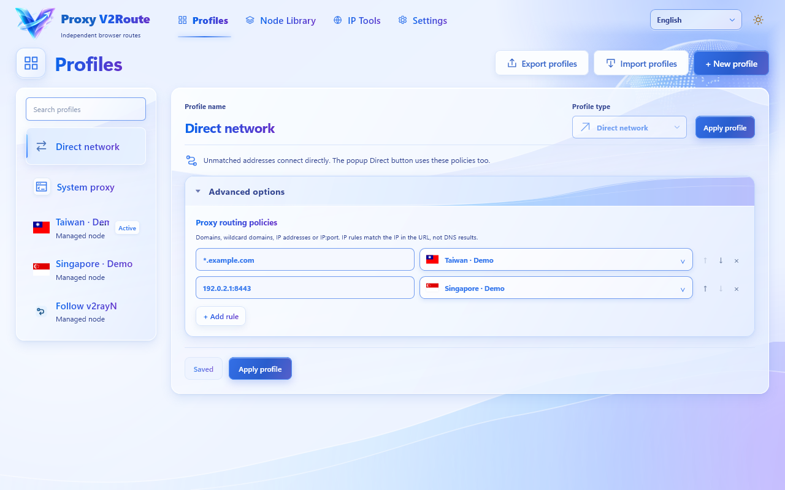

  

<h1 align="center">Proxy V2Route</h1>

<strong>Dein Browser. Deine eigene Route.</strong>

Verwalte Proxy-Profile, Knoten und Verbindungstests für deinen Browser an einem Ort.

<a href="README.md">简体中文</a> · <a href="README.en.md">English</a> · <a href="README.zh-TW.md">繁體中文</a> · <a href="README.ja.md">日本語</a> · <a href="README.es.md">Español</a> · <strong>Deutsch</strong>

<a href="https://velumarc.github.io/ProxyV2Route/?lang=en">Website (Chinesisch/Englisch)</a> · <a href="INSTALL.md">Installation</a> · <a href="https://github.com/VelumArc/ProxyV2Route/issues">Problem melden</a>

---

**1.2.73** · Windows 10/11 x64 · .NET Framework 4.5.2+ · Chrome 120+ / Firefox 140+

> [Windows-Installationsanleitung](https://github.com/VelumArc/ProxyV2Route/blob/main/INSTALL.md) · [Komplettpaket und Quellcode](https://github.com/VelumArc/ProxyV2Route/releases/tag/v1.2.73). Der Installer enthält die lokale Begleitkomponente und Xray und ist derzeit nicht codesigniert. Die Chrome-Erweiterung ist im [Chrome Web Store](https://chromewebstore.google.com/detail/proxy-v2route/mngpdlmiimigbloccmolkjbcagonijlm) erhältlich. Die Firefox-Erweiterung ist noch nicht signiert; eine dauerhafte Installation erfordert die Signatur von Mozilla.

Direktverbindung und Systemproxy lassen sich in der Profilliste bearbeiten. Die Schaltflächen in der Symbolleiste verwenden dieselben Regeln. Bei Knoten- und manuellen Profilen haben Ausnahmen Vorrang. Danach gilt die erste passende Proxyregel, sonst die Standardroute.

Unten sichert „Speichern“ die Änderungen. „Profil anwenden“ speichert sie und wechselt sofort zur neuen Route. Eigene Profile können Sie oben rechts löschen.

Tatsächliche englische Oberfläche mit fiktiven Demo-Profilen, ohne persönliche Knotendaten. Klicke auf das Bild für die volle Größe.

## Funktionen

- **Profile:** Knotenverbindungen, manuelle HTTP(S)/SOCKS-Proxys, automatische Regeln und PAC; wechsle zu Direktverbindung, System-Proxy oder dem laufenden v2rayN-Endpunkt.
- **Domain-Regeln:** Leite Websites über einen Knoten oder ein vorhandenes Profil. Mehrere Domains lassen sich in einer Zeile durch Kommas trennen.
- **Knoten und Abonnements:** importieren, suchen, ausblenden, benannte Gruppen anlegen und sortieren; regelmäßige Abonnement-Aktualisierungen sind optional.
- **Vorgeschaltete Proxys und Ketten:** Basis-, vorgeschalteter Proxy- und Kettenmodus behalten getrennte Einstellungen. Speichere den gewählten Modus und wende das Profil an, um die Route zu verwenden. Alle drei bieten Latenztests für jeden Pfadabschnitt und eine Stoppfunktion.
- **Netzwerkdiagnose:** Knotenmessungen, Ausgangs-IP, Download/Upload, Ping, TCPing, MTR und Erreichbarkeit von Websites.
- **Oberfläche und Umzug:** 55 Sprach-/Regionsoptionen, helle/dunkle Designs und Profilexport mit den verwendeten Knoten und Routen. Die ergänzten Übersetzungen der Oberfläche sind maschinell erstellte Entwürfe und noch nicht alle manuell geprüft.

## Erste Schritte

1. Starte den Installer oder `V2Route-Setup.exe` aus dem Komplettpaket, um die Windows-Begleitkomponente und Xray gemeinsam zu installieren. Knotenverbindungen und MTR benötigen diese Komponente; eine separate Installation von v2rayN oder einem MTR-Werkzeug ist nicht nötig.
2. Installiere die Chrome-Erweiterung aus dem [Chrome Web Store](https://chromewebstore.google.com/detail/proxy-v2route/mngpdlmiimigbloccmolkjbcagonijlm). Wie du ein lokales Paket lädst, steht in der [Installationsanleitung](INSTALL.md#chrome). Firefox: Lade die unsignierte XPI oder `firefox-extension/manifest.json` unter `about:debugging` vorübergehend. Nach einem Firefox-Neustart muss sie erneut geladen werden.
3. Importiere deine eigenen Knoten oder Abonnements, erstelle ein Profil und wende es an. v2rayN dient optional als Knotenquelle oder laufender Endpunkt. Dieses Projekt stellt keine Proxy-Server oder Abonnements bereit.

[Installation, Updates und Sicherungen (Chinesisch/Englisch)](INSTALL.md) · [Aus dem Quellcode bauen](SOURCES.md) · [Aktuelles Quellcode-ZIP](https://github.com/VelumArc/ProxyV2Route/archive/refs/heads/main.zip)

## Datenschutz und Hilfe

Einstellungen und Zugangsdaten der Knoten bleiben auf deinem Gerät und werden nicht an den Entwickler gesendet. Netzwerkwerkzeuge kontaktieren ihre jeweiligen Anbieter; beim Öffnen des Popups oder IP-Bereichs wird die Ausgangs-IP geprüft. Profilsicherungen enthalten Zugangsdaten und sind **nicht verschlüsselt**. Bewahre sie sicher auf. Testergebnisse garantieren keinen Zugriff auf Websites, Konten oder regionale Dienste.

[Datenschutz](docs/PRIVACY.md) · [Browser-Berechtigungen](docs/PERMISSIONS.md) · [Probleme melden](https://github.com/VelumArc/ProxyV2Route/issues). Nenne die Version und die Schritte zur Reproduktion. Entferne Zugangsdaten und persönliche Informationen; vertrauliche Meldungen bitte an **1313333@gmail.com**.

Der Projektcode steht unter [GPL-3.0-or-later](LICENSE-GPL-3.0.txt). Komponenten Dritter behalten ihre Lizenzen und Urheberhinweise; siehe [SOURCES.md](SOURCES.md) und die mitgelieferten Hinweise.
