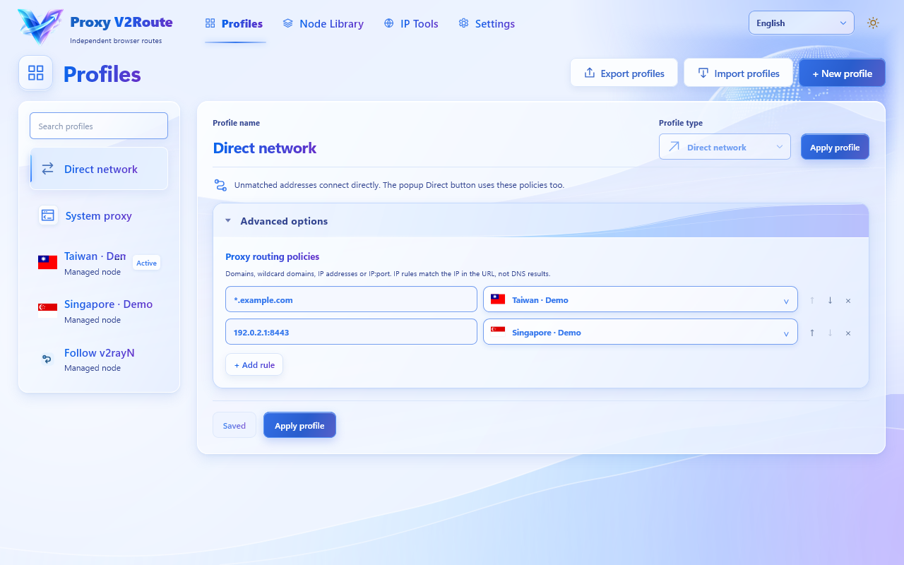

  

<h1 align="center">Proxy V2Route</h1>

<strong>Your browser. Your own route.</strong>

Manage browser proxy profiles, nodes and connection checks in one workspace.

<a href="README.md">简体中文</a> · <strong>English</strong> · <a href="README.zh-TW.md">繁體中文</a> · <a href="README.ja.md">日本語</a> · <a href="README.es.md">Español</a> · <a href="README.de.md">Deutsch</a>

<a href="https://velumarc.github.io/ProxyV2Route/?lang=en">Project website</a> · <a href="INSTALL.md">Installation</a> · <a href="https://github.com/VelumArc/ProxyV2Route/issues">Report an issue</a>

---

**1.2.73** · Windows 10/11 x64 · .NET Framework 4.5.2+ · Chrome 120+ / Firefox 140+

## Get started in three steps

1. **Install the browser extension.** Install the Chrome extension from the [Chrome Web Store](https://chromewebstore.google.com/detail/proxy-v2route/mngpdlmiimigbloccmolkjbcagonijlm). Firefox is awaiting review; follow the [local testing guide](INSTALL.md#firefox) to load the unsigned package temporarily, and reload it after restarting Firefox.
2. **[Install the Windows companion — required for node routes](https://github.com/VelumArc/ProxyV2Route/blob/main/INSTALL.md#windows-companion).** The installer includes Python, Xray and MTR diagnostics; no separate installation is needed. v2rayN is only an optional node source or Follow endpoint.
3. **Check the connection, import and connect.** Open extension **Settings** and click **Check again**. Once connected, import your own nodes or subscriptions, create a profile and click **Apply profile**, then check the exit IP in IP Tools.

> The Windows installer is currently unsigned. Permanent Firefox installation requires Mozilla signing. This project does not provide proxy servers or subscriptions. [Complete package and source](https://github.com/VelumArc/ProxyV2Route/releases/tag/v1.2.73)

Actual product interface with synthetic demo profiles and no personal node data. Select the image to view full size.

## Features

- **Profiles:** node routes, manual HTTP(S)/SOCKS proxies, automatic rules and PAC; switch to Direct, System or Follow v2rayN.
- **Domain routing:** send sites through a node or an existing profile; use commas for multiple domains in one row.
- **Nodes and subscriptions:** import, search, hide, name groups and reorder them; optionally schedule subscription updates.
- **Predecessors and chains:** basic, predecessor and chain modes retain separate configurations. Save the selected mode, then apply the profile to use its route; all three offer per-path latency checks and Stop.
- **Network checks:** node measurements, exit IP, download/upload, Ping, TCPing, MTR and website reachability.
- **Interface and portability:** 55 language/region options, light/dark themes and profile exports with their nodes and paths. Newly added interface translations are machine-generated drafts and have not all undergone human review.

Edit Direct and System in Profiles. Their toolbar shortcuts apply the same rules. For node and manual profiles, Advanced options checks bypass addresses first, then applies the first matching proxy policy. Remaining requests use the profile’s default route.

In the footer, Save keeps your edits for later. Apply profile saves them and switches immediately. You can delete a custom profile from its top-right corner.

[Installation, upgrades and backups](INSTALL.md) · [Build from source](SOURCES.md) · [Current source ZIP](https://github.com/VelumArc/ProxyV2Route/archive/refs/heads/main.zip)

## Privacy and support

Settings and node credentials stay on your device and are not sent to the developer. Network tools contact their providers; opening the popup or IP workspace checks your exit IP. Profile backups contain node credentials and are **not encrypted**. Keep them private. Diagnostic results do not guarantee website, account or regional-service access.

[Privacy](docs/PRIVACY.md) · [Browser permissions](docs/PERMISSIONS.md) · [Issues](https://github.com/VelumArc/ProxyV2Route/issues). Include your version and reproduction steps, and remove credentials and personal data. Send sensitive reports to **1313333@gmail.com**.

Project code uses [GPL-3.0-or-later](LICENSE-GPL-3.0.txt). Third-party components retain their licenses and attribution; see [SOURCES.md](SOURCES.md) and the bundled notices.
