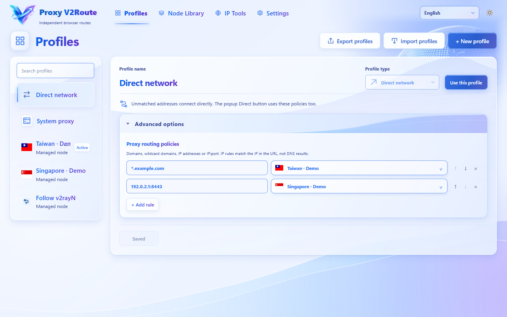

  

<h1 align="center">Proxy V2Route</h1>

<strong>Tu navegador. Tu propia ruta.</strong>

Gestiona perfiles de proxy, nodos y pruebas de conexión del navegador desde un solo espacio.

<a href="README.md">简体中文</a> · <a href="README.en.md">English</a> · <a href="README.zh-TW.md">繁體中文</a> · <a href="README.ja.md">日本語</a> · <strong>Español</strong> · <a href="README.de.md">Deutsch</a>

<a href="https://velumarc.github.io/ProxyV2Route/?lang=en">Sitio web (chino/inglés)</a> · <a href="INSTALL.md">Instalación</a> · <a href="https://github.com/VelumArc/ProxyV2Route/issues">Informar de un problema</a>

---

**1.2.65** · Windows 10/11 x64 · .NET Framework 4.5.2+ · Chrome 120+ / Firefox 140+

> [Instalador para Windows](https://github.com/VelumArc/ProxyV2Route/releases/download/v1.2.65/Proxy-V2Route-Setup-1.2.65-Windows-x64.exe) · [Paquete completo y código fuente](https://github.com/VelumArc/ProxyV2Route/releases/tag/v1.2.65). El instalador incluye el componente local y Xray; actualmente no tiene firma de código. La extensión para Chrome está disponible en [Chrome Web Store](https://chromewebstore.google.com/detail/proxy-v2route/mngpdlmiimigbloccmolkjbcagonijlm). La extensión de Firefox aún no está firmada y necesita la firma de Mozilla para una instalación permanente.

Puedes editar la conexión directa y el proxy del sistema desde Perfiles. Los accesos de la barra de herramientas aplican las mismas reglas. En los perfiles de nodo y manuales, las exclusiones tienen prioridad. Después se aplica la primera regla coincidente o, en su defecto, la ruta predeterminada.

Interfaz real en inglés con perfiles ficticios de demostración, sin datos personales de nodos. Selecciona la imagen para verla a tamaño completo.

## Funciones

- **Perfiles:** rutas mediante nodos, proxies HTTP(S)/SOCKS manuales, reglas automáticas y PAC; cambia a conexión directa, proxy del sistema o seguimiento de v2rayN.
- **Rutas por dominio:** asigna sitios a un nodo o perfil existente; separa varios dominios con comas en una misma fila.
- **Nodos y suscripciones:** importa, busca, oculta, crea grupos con nombre y reordénalos; activa las actualizaciones periódicas de suscripciones si las necesitas.
- **Proxies previos y cadenas:** los modos básico, proxy previo y cadena conservan configuraciones independientes. Guarda el modo para usar su ruta; los tres permiten medir la latencia de cada tramo y detener la prueba.
- **Diagnóstico de red:** mediciones de nodos, IP de salida, descarga/subida, Ping, TCPing, MTR y acceso a sitios web.
- **Interfaz y migración:** 55 opciones de idioma/región, temas claro/oscuro y exportación de perfiles con sus nodos y rutas. Las traducciones de interfaz añadidas son borradores generados automáticamente y no todas han pasado una revisión humana.

## Primeros pasos

1. Ejecuta el instalador o `V2Route-Setup.exe` del paquete completo para instalar juntos el componente de Windows y Xray. Las rutas mediante nodos y MTR necesitan este componente; no hace falta instalar v2rayN ni una herramienta MTR por separado.
2. Chrome: extrae el paquete local de Chrome, activa el modo de desarrollador en `chrome://extensions` y carga la carpeta que contiene `manifest.json`. Firefox: carga temporalmente el XPI sin firmar o `firefox-extension/manifest.json` desde `about:debugging`; tendrás que volver a cargarlo tras reiniciar Firefox.
3. Importa tus propios nodos o suscripciones, crea un perfil y aplícalo. v2rayN es una fuente de nodos o un destino de seguimiento opcional; este proyecto no proporciona servidores proxy ni suscripciones.

[Instalación, actualizaciones y copias de seguridad (chino/inglés)](INSTALL.md) · [Compilar desde el código fuente](SOURCES.md) · [ZIP del código fuente actual](https://github.com/VelumArc/ProxyV2Route/archive/refs/heads/main.zip)

## Privacidad y soporte

La configuración y las credenciales de los nodos se guardan en tu equipo y no se envían al desarrollador. Las herramientas de red contactan con sus proveedores; abrir la ventana emergente o la sección IP comprueba tu IP de salida. Las copias de los perfiles contienen credenciales y **no están cifradas**. Guárdalas de forma segura. Los resultados no garantizan el acceso a sitios, cuentas o servicios regionales.

[Privacidad](docs/PRIVACY.md) · [Permisos del navegador](docs/PERMISSIONS.md) · [Problemas](https://github.com/VelumArc/ProxyV2Route/issues). Incluye la versión y los pasos para reproducir el problema; elimina credenciales y datos personales. Para informes confidenciales: **1313333@gmail.com**.

El código del proyecto utiliza [GPL-3.0-or-later](LICENSE-GPL-3.0.txt). Los componentes de terceros conservan sus licencias y atribuciones; consulta [SOURCES.md](SOURCES.md) y los avisos incluidos.
