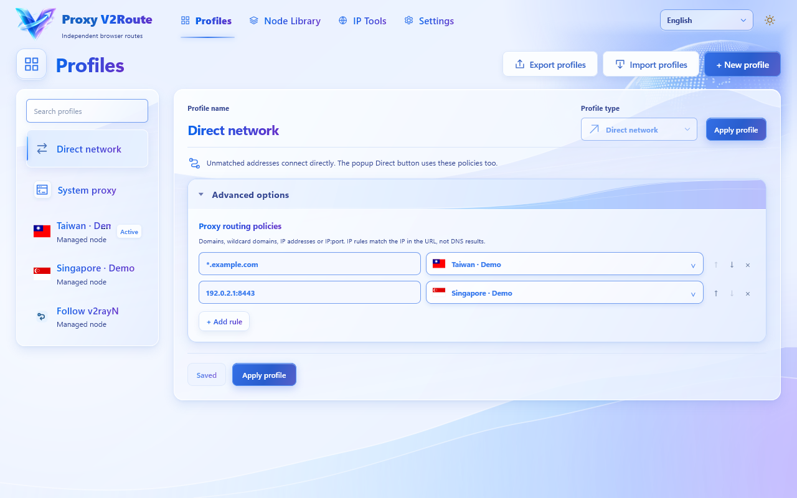

  

<h1 align="center">Proxy V2Route</h1>

<strong>ブラウザーに、自分だけの接続経路を。</strong>

ブラウザーのプロキシプロファイル、ノード、接続テストを一か所で管理します。

<a href="README.md">简体中文</a> · <a href="README.en.md">English</a> · <a href="README.zh-TW.md">繁體中文</a> · <strong>日本語</strong> · <a href="README.es.md">Español</a> · <a href="README.de.md">Deutsch</a>

<a href="https://velumarc.github.io/ProxyV2Route/?lang=en">公式サイト（中国語／英語）</a> · <a href="INSTALL.md">インストール</a> · <a href="https://github.com/VelumArc/ProxyV2Route/issues">問題を報告</a>

---

**公開バージョン：**Chrome 拡張機能 1.2.72 · Firefox 拡張機能 1.2.74 · Windows 連携コンポーネント 1.2.74

**動作環境：**Windows 10/11 x64 · .NET Framework 4.5.2+ · Chrome 120+ / Firefox 140+

## 3 ステップで使い始める

1. **ブラウザー拡張機能をインストール。** [Chrome ウェブストア](https://chromewebstore.google.com/detail/proxy-v2route/mngpdlmiimigbloccmolkjbcagonijlm)または [Firefox Add-ons](https://addons.mozilla.org/firefox/addon/proxy-v2route/)からインストールできます。
2. **[Windows 連携コンポーネントをインストール — ノード経由の接続に必須](https://github.com/VelumArc/ProxyV2Route/blob/main/INSTALL.md#windows-companion)。** Python、Xray、MTR 診断が含まれ、別途インストールする必要はありません。v2rayN は任意のノード取得元、または追従先として使えます。
3. **接続を確認してインポート・適用。** 拡張機能の設定で接続を再確認します。接続できたら自分のノードやサブスクリプションをインポートし、プロファイルを作成して適用します。最後に IP ツールで出口 IP を確認します。

> Windows インストーラーは現在未署名です。このプロジェクトはプロキシサーバーやサブスクリプションを提供しません。[完全パッケージとソースコード](https://github.com/VelumArc/ProxyV2Route/releases/tag/v1.2.74)

架空のデモプロファイルを使用した実際の英語画面です。個人のノード情報は含みません。画像を選択すると原寸で表示します。

## 主な機能

- **プロファイル：**ノード経由の接続、手動 HTTP(S)/SOCKS プロキシ、自動ルール、PAC。直接接続、システムプロキシ、v2rayN への追従に対応します。
- **アドレス別ルーティング：**ドメイン、ワイルドカードドメイン、IP アドレス、IP:ポートごとにノードや既存のプロファイルを指定できます。1 行に複数のアドレスをカンマ区切りで入力できます。
- **ノードとサブスクリプション：**インポート、検索、非表示、グループ化、並べ替え。必要に応じてサブスクリプションの定期更新を有効にできます。
- **前段プロキシとチェーン：**基本・前段プロキシ・チェーンの設定を個別に保持します。どのモードも経路ごとの遅延測定と停止に対応します。
- **ネットワーク診断：**ノードの速度、出口 IP、ダウンロード／アップロード、Ping、TCPing、MTR、サイトへの到達性を確認できます。
- **表示と移行：**55 の言語・地域オプション、ライト／ダークテーマ、ノードと経路を含むプロファイルのエクスポート。一部の UI 翻訳は機械翻訳で、人手による確認がまだ済んでいません。

直接接続とシステムプロキシのプロファイルは、ツールバーのショートカットと保存済みルールを共有します。除外先、最初に一致するルール、プロファイルの既定経路の順に適用します。

「保存」は変更を記録します。「プロファイルを適用」は保存と経路の切り替えを同時に行います。

[インストール・更新・バックアップ（中国語／英語）](INSTALL.md) · [ソースからビルド](SOURCES.md) · [現在のソース ZIP](https://github.com/VelumArc/ProxyV2Route/archive/refs/heads/main.zip)

## プライバシーとサポート

設定とノードの認証情報は端末内に保存され、開発者には送信されません。ネットワークツールは各サービス提供者に接続します。ポップアップや IP ツールを開いたとき、または経路の切り替えに成功したときに、ipify を使って回数や時間を制限した出口 IP の確認を行います。プロファイルのバックアップには認証情報が含まれ、**暗号化されていません**。安全に保管してください。診断結果はサイト、アカウント、地域限定サービスの利用を保証しません。

[プライバシー](docs/PRIVACY.md) · [ブラウザーの権限](docs/PERMISSIONS.md) · [問題の報告](https://github.com/VelumArc/ProxyV2Route/issues)。バージョンと再現手順を添え、認証情報や個人情報を取り除いてください。機密性の高い報告は **1313333@gmail.com** へ。

プロジェクトのコードは [GPL-3.0-or-later](LICENSE-GPL-3.0.txt) で提供されます。サードパーティーのコンポーネントにはそれぞれのライセンスと著作者表示が適用されます。[SOURCES.md](SOURCES.md) と同梱の通知を参照してください。
