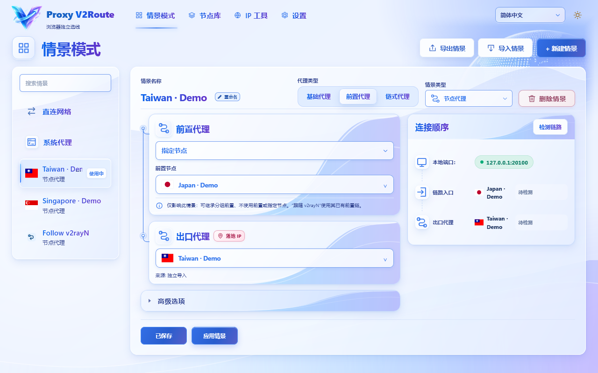

  

<h1 align="center">Proxy V2Route</h1>

<strong>你的浏览器。你的独立线路。</strong>

在一个工作区管理浏览器代理情景、节点与连接检测。

<strong>简体中文</strong> · <a href="README.en.md">English</a> · <a href="README.zh-TW.md">繁體中文</a> · <a href="README.ja.md">日本語</a> · <a href="README.es.md">Español</a> · <a href="README.de.md">Deutsch</a>

<a href="https://velumarc.github.io/ProxyV2Route/?lang=zh">项目主页</a> · <a href="INSTALL.md">安装说明</a> · <a href="SOURCES.md#source-map">源码导航</a> · <a href="https://github.com/VelumArc/ProxyV2Route/issues">问题反馈</a>

---

**已发布版本：**Chrome 扩展 1.2.72 · Firefox 扩展 1.2.74 · Windows 配套组件 1.2.74

**环境要求：**Windows 10/11 x64 · .NET Framework 4.5.2+ · Chrome 120+ / Firefox 140+

## 三步开始使用

1. **安装浏览器扩展。** 从 [Chrome 应用商店](https://chromewebstore.google.com/detail/proxy-v2route/mngpdlmiimigbloccmolkjbcagonijlm)或 [Firefox 附加组件商店](https://addons.mozilla.org/firefox/addon/proxy-v2route/)安装。
2. **[安装 Windows 配套组件——使用节点线路必需](https://github.com/VelumArc/ProxyV2Route/blob/main/INSTALL.md#windows-companion)。** 安装器已包含 Python、Xray 和 MTR 诊断，无需另装；v2rayN 仅是可选节点来源或“跟随”入口。
3. **检查连接，导入并使用。** 打开扩展“设置”，点击“重新检测”；连接成功后导入自己的节点或订阅，创建情景并点击“应用情景”，再到 IP 工具确认出口。

> Windows 安装器目前未作代码签名。本项目不提供代理服务器或订阅。[完整包与源码](https://github.com/VelumArc/ProxyV2Route/releases/tag/v1.2.74)

实际产品界面，使用虚构演示情景，不含个人节点数据。点击查看原图。

## 功能

- **情景切换：**节点代理、手动 HTTP(S)/SOCKS 代理、自动规则与 PAC；支持直连、系统代理及跟随 v2rayN。
- **地址分流：**按域名、泛域名、IP 或 IP:端口选择节点或已有情景；同一行可用逗号分隔多个地址。
- **节点与订阅：**导入、搜索、隐藏、分组和排序；可按需启用订阅定时更新。
- **前置与链路：**基础、前置和链式代理分别保留配置，均支持逐段延迟检测与停止。
- **网络检测：**节点测速、出口 IP、下载／上传、Ping、TCPing、MTR 与网站连通检测。
- **界面与迁移：**55 个语言／地区选项、深浅主题；导出情景及所用节点与链路。部分界面译文仍为未经人工审校的机器翻译。

直连与系统情景、工具栏快捷按钮共用规则。分流顺序为：不代理的地址 → 第一条匹配的策略 → 情景默认线路。

「保存」只记录修改；「应用情景」保存并立即切换。

[安装、升级与备份](INSTALL.md) · [从源码构建](SOURCES.md#zh-build) · [当前源码 ZIP](https://github.com/VelumArc/ProxyV2Route/archive/refs/heads/main.zip)

## 隐私与支持

配置和节点凭据保存在本机，不上传给开发者。网络工具会联系相应服务商；打开弹窗或 IP 工具、成功切换线路时，会向 ipify 发起有限的出口 IP 检查。情景备份含节点凭据且**未加密**，请妥善保管。检测结果不保证网站、账号或地区服务可用。

[隐私说明](docs/PRIVACY.md) · [浏览器权限](docs/PERMISSIONS.md) · [问题反馈](https://github.com/VelumArc/ProxyV2Route/issues)。反馈时请提供版本与复现步骤，移除凭据和个人数据；敏感问题联系 **1313333@gmail.com**。

项目代码采用 [GPL-3.0-or-later](LICENSE-GPL-3.0.txt)；第三方组件保留各自许可与署名，详见 [SOURCES.md](SOURCES.md) 和随包声明。
