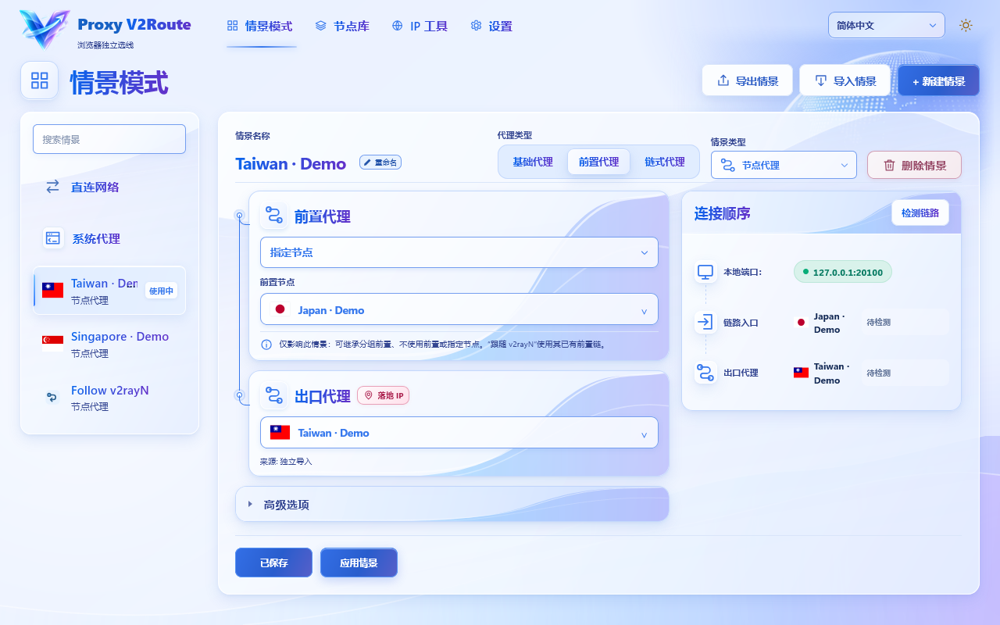

  

<h1 align="center">Proxy V2Route</h1>

<strong>你的瀏覽器。你的獨立路線。</strong>

在同一個工作區管理瀏覽器代理情境、節點與連線檢測。

<a href="README.md">简体中文</a> · <a href="README.en.md">English</a> · <strong>繁體中文</strong> · <a href="README.ja.md">日本語</a> · <a href="README.es.md">Español</a> · <a href="README.de.md">Deutsch</a>

<a href="https://velumarc.github.io/ProxyV2Route/?lang=zh">專案網站（簡中／英文）</a> · <a href="INSTALL.md">安裝說明</a> · <a href="https://github.com/VelumArc/ProxyV2Route/issues">問題回報</a>

---

**已發布版本：**Chrome 擴充套件 1.2.72 · Firefox 擴充套件 1.2.74 · Windows 配套元件 1.2.74

**環境需求：**Windows 10/11 x64 · .NET Framework 4.5.2+ · Chrome 120+ / Firefox 140+

## 三步開始使用

1. **安裝瀏覽器擴充套件。** 從 [Chrome 線上應用程式商店](https://chromewebstore.google.com/detail/proxy-v2route/mngpdlmiimigbloccmolkjbcagonijlm)或 [Firefox 附加元件商店](https://addons.mozilla.org/firefox/addon/proxy-v2route/)安裝。
2. **[安裝 Windows 配套元件——使用節點路線必需](https://github.com/VelumArc/ProxyV2Route/blob/main/INSTALL.md#windows-companion)。** 安裝程式已包含 Python、Xray 與 MTR 診斷，不必另裝；v2rayN 僅是選用的節點來源或「跟隨」入口。
3. **檢查連線，匯入並使用。** 開啟擴充套件「設定」，點選「重新檢測」；連線成功後匯入自己的節點或訂閱，建立情境並點選「套用情境」，再到 IP 工具確認出口。

> Windows 安裝程式目前未經程式碼簽章。本專案不提供代理伺服器或訂閱。[完整套件與原始碼](https://github.com/VelumArc/ProxyV2Route/releases/tag/v1.2.74)

實際產品的簡體中文介面，使用虛構示範情境，不含個人節點資料。點選查看原圖。

## 功能

- **情境切換：**節點代理、手動 HTTP(S)/SOCKS 代理、自動規則與 PAC；支援直接連線、系統代理及跟隨 v2rayN。
- **位址分流：**依網域、萬用網域、IP 或 IP:連接埠選擇節點或既有情境；同一列可用逗號分隔多個位址。
- **節點與訂閱：**匯入、搜尋、隱藏、分組與排序；可視需要啟用訂閱定時更新。
- **前置與代理鏈：**基礎、前置和鏈式代理分別保留設定，皆支援逐段延遲檢測與停止。
- **網路檢測：**節點測速、出口 IP、下載／上傳、Ping、TCPing、MTR 與網站連線檢測。
- **介面與移轉：**55 個語言／地區選項、明暗主題；匯出情境及所用節點與代理鏈。部分介面譯文仍為未經人工校對的機器翻譯。

直連與系統情境、工具列捷徑共用已儲存的規則。分流順序為：不代理的位址 → 第一條符合的策略 → 情境預設路線。

「儲存」只記錄變更；「套用情境」儲存並立即切換。

[安裝、升級與備份（簡中／英文）](INSTALL.md) · [原始碼建置](SOURCES.md) · [目前原始碼 ZIP](https://github.com/VelumArc/ProxyV2Route/archive/refs/heads/main.zip)

## 隱私與支援

設定和節點憑證保存在本機，不會上傳給開發者。網路工具會連線至各服務提供者；開啟彈出視窗或 IP 工具、成功切換路線時，會向 ipify 發出有限的出口 IP 檢查。情境備份包含節點憑證且**未加密**，請妥善保管。檢測結果不保證網站、帳號或地區服務可用。

[隱私說明](docs/PRIVACY.md) · [瀏覽器權限](docs/PERMISSIONS.md) · [問題回報](https://github.com/VelumArc/ProxyV2Route/issues)。回報時請提供版本與重現步驟，移除憑證和個人資料；敏感問題請聯絡 **1313333@gmail.com**。

專案程式碼採用 [GPL-3.0-or-later](LICENSE-GPL-3.0.txt)；第三方元件保留各自的授權與署名，詳見 [SOURCES.md](SOURCES.md) 及隨附聲明。
